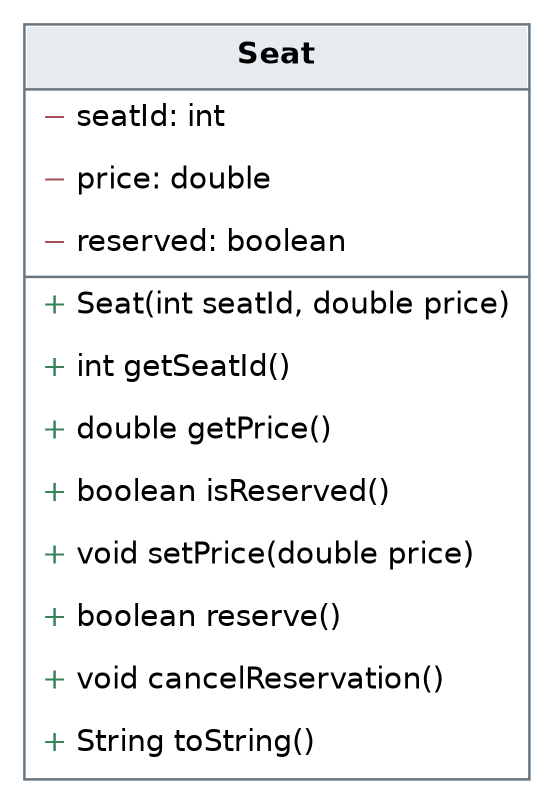
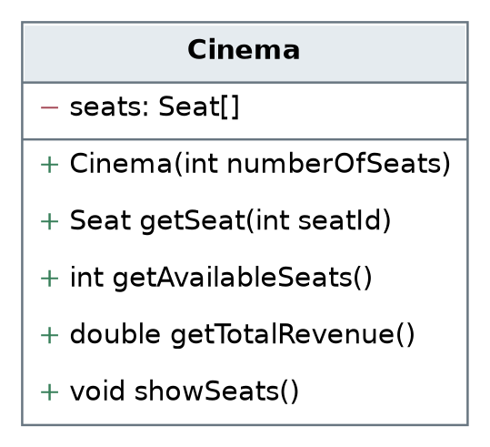
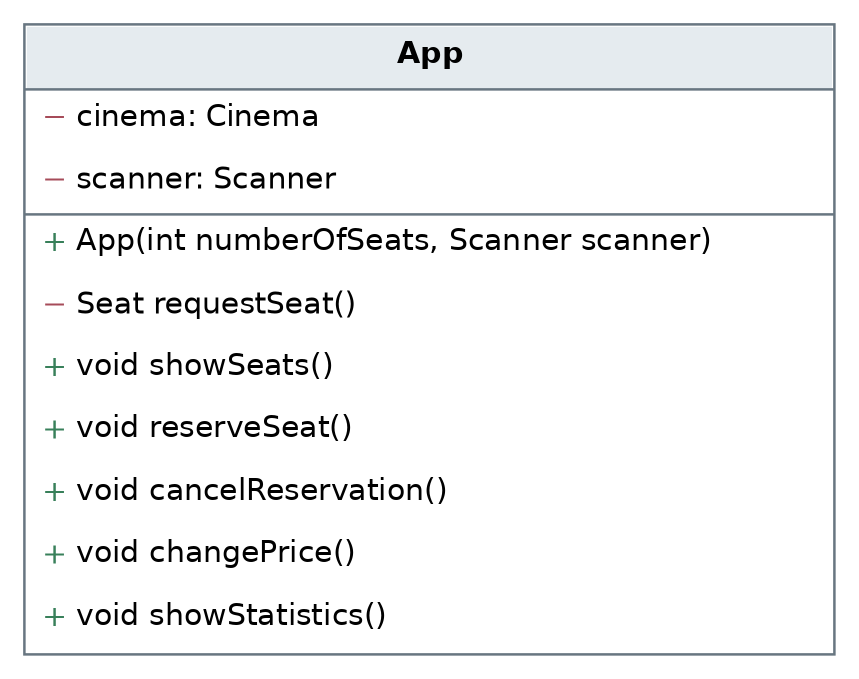

# CSDC – Programmierung 1 ILV
## Übungsbeispiel: Cinema Management System

### Beschreibung

Es soll ein einfaches Cinema Management System implementiert werden.

Ein Kino (`Cinema`) besteht aus x Sitzplätzen (`Seat`). Jeder Sitzplatz verfügt über eine eindeutige Nummer, einen Ticketpreis und die Information, ob der Sitzplatz bereits reserviert wurde. Die `App` verfügt über ein Command Line Interface (CLI), mit dem Sitzplätze reserviert, Reservierungen storniert, Ticketpreise geändert und Informationen zu den Sitzplätzen ausgegeben werden können.

## Aufgabe 1
### Klasse Seat

Schreiben Sie zunächst eine Klasse `Seat`. Die Klasse hat drei private Attribute: `seatId`, `price` und `reserved` (siehe Abbildung 1). 



*Abbildung 1: Attribute und Methoden der Klasse Seat.*

Die Klasse soll über einen einzigen Konstruktor verfügen, dem zwei Parameter übergeben werden: `seatId` und `price`. Bei der Initialisierung eines Sitzplatzes ist dieser noch nicht reserviert. Sie können davon ausgehen, dass dem Konstruktor nur gültige Parameter übergeben werden. 

Schreiben Sie für alle drei Attribute jeweils einen Getter entsprechend Abbildung 1. 

Schreiben Sie eine Methode `setPrice`, welche den Ticketpreis eines Sitzplatzes verändert. Der Ticketpreis darf nur verändert werden, wenn der Sitzplatz noch nicht reserviert wurde und der übergebene Preis größer als 0 ist. Andernfalls bleibt der bisherige Preis unverändert. 

Schreiben Sie eine Methode `reserve`, welche einen Sitzplatz reserviert. Sollte der Sitzplatz bereits reserviert sein, geben Sie `false` zurück. Andernfalls reservieren Sie den Sitzplatz und geben `true` zurück. 

Schreiben Sie eine Methode `cancelReservation`, welche eine bestehende Reservierung aufhebt. Sollte der Sitzplatz nicht reserviert sein, ändert sich nichts.

Implementieren Sie die Methode `toString` (`@Override` der Klasse `Object`), welche einen String wie folgt formatiert zurückliefert. Der Status ist abhängig davon, ob der Sitzplatz reserviert wurde oder nicht. 

```
Seat 1: Available
```

bzw.

```
Seat 1: Reserved
```

## Aufgabe 2
### Klasse Cinema (6 Punkte)

Schreiben Sie eine Klasse `Cinema`. Die Klasse hat ein privates Attribut `seats`, welches den Typ `Seat[]` hat (siehe Abbildung 2). 



*Abbildung 2: Attribute und Methoden der Klasse Cinema.*

Die Klasse soll über einen einzigen Konstruktor verfügen, dem nur ein Parameter übergeben wird (`numberOfSeats`). Der Konstruktor füllt das `seats`-Array mit `numberOfSeats` Instanzen der Klasse `Seat`.

Das erste Seat-Objekt muss die `seatId` 1 haben, die weiteren IDs sind fortlaufend. Der Ticketpreis wird bei der Initialisierung anhand der Sitzplatznummer festgelegt.

- Sitzplätze mit ungerader ID kosten 10 Euro.
- Sitzplätze mit gerader ID kosten 12 Euro.

Sollte `numberOfSeats` kleiner als 1 sein, initialisieren Sie das Kino mit einem einzigen Sitzplatz. 

Schreiben Sie eine Methode `getSeat`, welche anhand des Parameters `seatId` die entsprechende Seat-Instanz zurückgibt. Sollte kein Sitzplatz mit dieser ID existieren, geben Sie `null` zurück. 

Schreiben Sie eine Methode `getAvailableSeats`, welche die Anzahl aller noch nicht reservierten Sitzplätze im Kino zurückgibt. 

Schreiben Sie eine Methode `getTotalRevenue`, welche die Summe der Ticketpreise aller reservierten Sitzplätze zurückgibt. Noch nicht reservierte Sitzplätze werden bei der Berechnung nicht berücksichtigt. 
Schreiben Sie eine Methode `showSeats`, welche auf die Konsole eine Liste aller Sitzplätze mit dem jeweiligen Reservierungsstatus und Ticketpreis schreibt. Verwenden Sie dafür die `toString`-Methode der Klasse `Seat`. 

Beispiel:

```
Seat 1: Available (10.0 EUR)
Seat 2: Reserved (12.0 EUR)
Seat 3: Available (10.0 EUR)
Seat 4: Reserved (12.0 EUR)
```

Nach jedem Listeneintrag (auch dem letzten) muss ein Zeilenumbruch erfolgen.

## Aufgabe 3
### Klasse App 

Schreiben Sie eine Klasse `App`. Diese implementiert das CLI. Die Klasse hat zwei private Attribute: `cinema` mit Typ `Cinema` und `scanner` mit Typ `Scanner` (siehe Abbildung 3). 



*Abbildung 3: Attribute und Methoden der Klasse App.*

Die Klasse soll über einen einzigen Konstruktor verfügen, dem zwei Parameter übergeben werden: `numberOfSeats` und `scanner`. Mit dem ersten Parameter instanziiert die Klasse das Attribut `cinema`. Der zweite Parameter ist ein bereits instanziierter Scanner, den das CLI für alle Scan-Operationen verwendet. 
**Hinweis:** Ein Beispiel-Lauf findet sich am Ende des Dokuments. Sie können davon ausgehen, dass Eingaben dem erwarteten Datentyp entsprechen.

Schreiben Sie eine Methode `showSeats`, welche alle Sitzplätze auf der Konsole ausgibt. Die Formatierung ergibt sich aus `Cinema.showSeats`. 

Schreiben Sie eine private Methode `requestSeat`. Diese Hilfsmethode wird verwendet, um die Sitzplatznummer vom Benutzer abzufragen. Sie liest mit dem Prompt `Seat ID: ` die Sitzplatznummer ein. Sollte kein Sitzplatz mit dieser ID existieren, geben Sie den String `Seat not found!` mit Zeilenumbruch aus und geben `null` zurück. Ansonsten geben Sie die Referenz auf das Seat-Objekt zurück. 

Schreiben Sie eine Methode `reserveSeat`, mit der ein Benutzer einen Sitzplatz reservieren kann. Verwenden Sie die Methode `requestSeat`. Liefert diese `null` zurück, beenden Sie die Methode.

Verwenden Sie anschließend die Methode `reserve` der Klasse `Seat`. Abhängig vom Rückgabewert geben Sie eine der folgenden Nachrichten auf der Konsole aus. 

```
Reservation successful!
```

bzw.

```
Seat is already reserved!
```

Schreiben Sie eine Methode `cancelReservation`, mit der ein Benutzer die Reservierung eines Sitzplatzes aufheben kann. Verwenden Sie erneut die Methode `requestSeat`. Sollte der Sitzplatz nicht existieren, beenden Sie die Methode. Sollte der Sitzplatz nicht reserviert sein, geben Sie `Seat is not reserved!` aus. Andernfalls heben Sie die Reservierung auf und geben `Reservation cancelled!` aus. 
Schreiben Sie eine Methode `changePrice`, mit der der Ticketpreis eines Sitzplatzes verändert werden kann. Verwenden Sie die Methode `requestSeat`.

- Existiert der Sitzplatz nicht, beenden Sie die Methode.
- Ist der Sitzplatz reserviert, geben Sie `Cannot change price of reserved seat!` aus und beenden Sie die Methode.
- Andernfalls lesen Sie mit dem Prompt `New price: ` den neuen Ticketpreis (`double`) ein.
- Ist der eingegebene Preis kleiner oder gleich 0, geben Sie `Invalid price!` aus und beenden Sie die Methode.
- Verwenden Sie anschließend die Methode `setPrice` der Klasse `Seat` und geben Sie den aktuellen Ticketpreis im Format `Current price: <price> EUR` aus.

Schreiben Sie eine Methode `showStatistics`, welche die Anzahl der noch verfügbaren Sitzplätze sowie die Summe der Ticketpreise aller reservierten Sitzplätze in folgendem Format ausgibt. 

```
Available seats: 2
Total revenue: 22.0 EUR
```

Alle Statusmeldungen und Statistikzeilen enden mit einem Zeilenumbruch.

### Implementierung der main-Methode (3 Punkte)

Schreiben Sie in der Klasse `App` eine öffentliche statische Methode `main(String[] args)` mit dem Rückgabetyp `void`.

Erstellen Sie einen Scanner für `System.in` und eine Instanz der Klasse `App` mit vier Sitzplätzen. Geben Sie anschließend einmalig folgendes Menü auf der Konsole aus. 

```text
=== Cinema Management ===

1 - Show seats
2 - Reserve seat
3 - Cancel reservation
4 - Change price
5 - Show statistics
0 - Exit
```

Lesen Sie in einer Schleife mit dem Prompt `> ` die Auswahl des Benutzers als Ganzzahl ein. Die Schleife soll erst beendet werden, wenn der Benutzer 0 eingibt. 

Verwenden Sie ein `switch`-Statement, um abhängig von der Eingabe die entsprechende Methode der App-Instanz aufzurufen.

| Eingabe | Aktion |
|---|---|
| 1 | `showSeats()` |
| 2 | `reserveSeat()` |
| 3 | `cancelReservation()` |
| 4 | `changePrice()` |
| 5 | `showStatistics()` |
| 0 | `Bye!` ausgeben und Programm beenden |
| Sonstige | `Invalid option!` ausgeben |

Schließen Sie den Scanner nach Beendigung der Schleife. 

## CLI Beispiel-Lauf

```text
=== Cinema Management ===

1 - Show seats
2 - Reserve seat
3 - Cancel reservation
4 - Change price
5 - Show statistics
0 - Exit
> 1
Seat 1: Available (10.0 EUR)
Seat 2: Available (12.0 EUR)
Seat 3: Available (10.0 EUR)
Seat 4: Available (12.0 EUR)
> 2
Seat ID: 1
Reservation successful!
> 2
Seat ID: 1
Seat is already reserved!
> 2
Seat ID: 2
Reservation successful!
> 4
Seat ID: 1
Cannot change price of reserved seat!
> 4
Seat ID: 3
New price: 15
Current price: 15.0 EUR
> 2
Seat ID: 3
Reservation successful!
> 3
Seat ID: 2
Reservation cancelled!
> 2
Seat ID: 8
Seat not found!
> 5
Available seats: 2
Total revenue: 25.0 EUR
> 1
Seat 1: Reserved (10.0 EUR)
Seat 2: Available (12.0 EUR)
Seat 3: Reserved (15.0 EUR)
Seat 4: Available (12.0 EUR)
> 9
Invalid option!
> 0
Bye!
```

